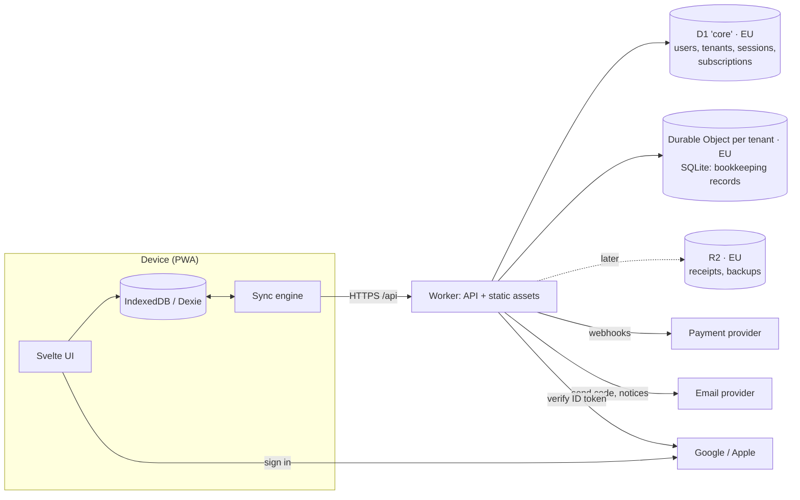

# Cloud sync, accounts and subscriptions — design

Status: phase 0 and phase 1 implemented (see §13). Sync is not live yet; see [STATUS.md](STATUS.md) for the current state and next steps.

## 1. Goals and non-goals

Goals

- Use InBalans on several devices (laptop, tablet, phone) with the same data.
- Keep the app **offline-first**: every device has a full local copy and works without a connection.
  Sync is optional; the app stays usable without an account.
- Strict data separation between customers (tenants), data stored in the **EU**.
- Paid subscriptions to cover running costs.
- Simple to operate for a one-person product: no servers to manage, low fixed costs.

Non-goals (for now)

- Real-time collaboration on the same document by several people.
- End-to-end encryption (see §11 for the trade-off).
- Long-term archiving on behalf of the customer (the statutory retention duty stays with the entrepreneur, see §10).

## 2. Architecture



- **One Cloudflare Worker** serves the static app *and* the `/api` routes on the same origin.
  Same origin means session cookies just work, with no CORS setup. Requests for static files are free.
  This replaces the current Pages project; deployment from Git stays the same.
  Pages Functions could also bind a Durable Object, but only one defined in a separate Worker, so a single Worker is simpler.
- **Central D1 database `core`** (created with `--jurisdiction=eu`): everything that crosses tenants.
- **One SQLite-backed Durable Object per tenant** (namespace restricted with `jurisdiction("eu")`), addressed by
  tenant id: the bookkeeping data of that tenant. This gives physical data separation, lets all requests for one
  tenant be handled in order (no sync races), allows per-tenant deletion, and requires no per-tenant configuration.
- **R2** (EU) later for receipt images and disaster-recovery exports.

Domains: the app (and its API under `/api`) runs on **`mijn.inbalans.app`**; the public website (explanation,
pricing, privacy statement, terms) on **`inbalans.app`**; e-mail is sent from `noreply@inbalans.app`.
Browser data is bound to the app's origin, so `mijn.inbalans.app` must never change.

A *tenant* is one administration (one business). A *user* is a person who logs in. Today one user has
one tenant, but the model allows more (e.g. two businesses, or an accountant with read access later).

## 3. Data model

### 3.1 Central D1 (`core`)

| Table | Key columns | Notes |
| --- | --- | --- |
| `users` | id, email, email_verified, name, created_at, deleted_at | `id` is internal; login methods hang off it |
| `identities` | user_id, provider, subject, email, created_at, last_used_at | provider = google / apple / email; unique (provider, subject) |
| `tenants` | id, name, created_at, status, delete_after | `status`: active / read_only / pending_deletion |
| `memberships` | user_id, tenant_id, role | `owner` now; `accountant` (read-only) later |
| `login_codes` | email, code_hash, expires_at, attempts | one-time login codes, 10 min validity |
| `auth_nonces` | nonce_hash, expires_at | single-use nonces for Google/Apple ID tokens, 5 min validity |
| `sessions` | id_hash, user_id, device_name, created_at, last_seen_at, expires_at | for the device list and remote log-out |
| `subscriptions` | tenant_id, provider, provider_customer_id, plan, status, current_period_end, trial_end | mirrored from payment-provider webhooks |
| `payment_events` | id, provider_event_id (unique), payload, received_at | idempotent webhook handling, audit |
| `audit_log` | id, tenant_id, user_id, action, at | login, export, deletion, plan changes |

### 3.2 Tenant Durable Object (SQLite)

The server stores records **generically** (JSON per record). The bookkeeping schema lives in the app, so new
fields or tables in the app need no server migration, and domain logic stays in one place (the client).

```sql
CREATE TABLE records (
  tbl         TEXT NOT NULL,     -- 'documents', 'categories', ...
  id          TEXT NOT NULL,     -- record UUID (same as on the device)
  data        TEXT NOT NULL,     -- full record as JSON
  updated_at  TEXT NOT NULL,     -- client timestamp, informational / tie-break
  deleted_at  TEXT,              -- tombstone
  rev         INTEGER NOT NULL,  -- server revision, strictly increasing per tenant
  device_id   TEXT NOT NULL,     -- who wrote it last
  PRIMARY KEY (tbl, id)
);
CREATE INDEX records_rev ON records(rev);

CREATE TABLE conflicts (          -- losing versions are kept, never silently dropped
  tbl TEXT, id TEXT, data TEXT, device_id TEXT, at TEXT
);
CREATE TABLE meta (key TEXT PRIMARY KEY, value TEXT);  -- schema_version, last_rev, locked_until
```

On first access after a deploy, the Durable Object runs any pending migrations of this small server schema
(the `schema_version` in `meta`), so schema changes roll out lazily per tenant.

### 3.3 Client additions

- Each local record gets `_rev` (server revision last seen, `null` = never synced) and `_dirty` (local change not yet pushed).
  `repo.save()` / `repo.remove()` set `_dirty = 1`.
- A `syncState` record holds `tenantId`, `deviceId`, `lastPulledRev` and `lastSyncAt`.
- One local Dexie database per tenant (`inbalans-<tenantId>`); the existing database stays the
  "on this device only" administration until the user connects it to an account (§6).

## 4. Sync protocol

One endpoint, push and pull in a single round trip:

```
POST /api/tenants/:tenantId/sync
{
  "deviceId": "…",
  "since": 1234,                       // lastPulledRev
  "changes": [                         // all _dirty records, in batches of ≤ 500
    { "tbl": "documents", "id": "…", "baseRev": 1200, "data": {…}, "updatedAt": "…", "deletedAt": null }
  ]
}
→
{
  "accepted":  [{ "tbl": "documents", "id": "…", "rev": 1240 }],
  "conflicts": [{ "tbl": "documents", "id": "…", "winner": { …record…, "rev": 1238 } }],
  "changes":   [ …records with rev > since, excluding the ones just accepted… ],
  "rev": 1240,
  "more": false                        // paginate pull with since=rev when true
}
```

Rules (in the tenant Durable Object, which processes one request at a time):

1. **Accept** a change when `baseRev` equals the stored `rev` (the device saw the latest version) or the record does not exist.
   The record gets the next `rev`.
2. **Conflict** when the stored `rev` is newer than `baseRev` (another device changed it in the meantime).
   The version with the latest `updatedAt` wins. The losing version is written to `conflicts`, and the client
   shows a small notice ("1 boeking is op een ander apparaat ook gewijzigd") so the user can check it.
   With one person on a few devices this is rare.
3. **Locked periods** (§10): changes to documents dated in a locked period are rejected, server side as well.
4. Server revisions are used for ordering, so device clocks never decide what is "new" except as a tie-break.

When the client syncs: on start, when the app regains focus, when the device comes back online,
0.8 seconds after a local change, and every 5 minutes while open. Open devices also keep a WebSocket to the
Durable Object (hibernation API, nearly free while idle; built in phase 1): after a change it sends only the
new revision to the other devices, which then sync as usual.

## 5. Authentication

No passwords. The login screen offers three options:

1. **Doorgaan met Google** — Google Identity Services (OpenID Connect, scopes `openid email profile`), popup flow.
2. **Doorgaan met Apple** — Sign in with Apple JS (`usePopup: true`), scopes `name email`.
3. **Inloggen met e-mail** — fallback for people without (or not wanting to use) Google/Apple, and for account recovery:
   a 6-digit code, also sent as a link. Codes are stored hashed, valid 10 minutes, max 5 attempts, rate limited per
   email and IP. A code is used and not only a link because on iOS a link opens Safari instead of the installed PWA.

Popups are used for Google and Apple instead of full-page redirects, so the installed PWA (notably on iOS) never
navigates away. **This is the first thing to verify on real iOS and Android devices** in phase 1.

### Verification (in the Worker)

- The client receives an **ID token** (JWT) from Google or Apple and posts it to `/api/auth/<provider>` together with a
  `nonce` the server issued just before (stored hashed, single use, 5 minutes).
- The Worker verifies signature (provider JWKS, cached), `iss`, `aud` (our client id), `exp`, and `nonce`.
  A small JWT library such as `jose` works in Workers; no third-party identity service is needed.
- Identity = (`provider`, `sub`). The `sub` is stable; e-mail addresses can change.

### Linking accounts

- One internal user can have several identities (Google, Apple, e-mail).
- On first sign-in with a new identity, it is linked to an existing user **only when the provider reports the e-mail
  as verified** (`email_verified`) and it matches that user's verified e-mail. Otherwise a new user is created.
- Settings → Account lists the linked methods with *Koppelen* / *Ontkoppelen* (the last method cannot be removed).

### Apple specifics

- Requires the Apple Developer Program (available). Configure a Services ID, the return domain and a Sign in with Apple key.
- The client secret for the token endpoint is a JWT signed with that key, valid at most 6 months; the Worker generates it
  on the fly, so there is nothing to rotate by hand. (With the popup ID-token flow the secret is only needed to revoke tokens.)
- Apple sends the user's name **only on the first authorization**; store it then.
- Users may hide their e-mail: Apple then provides a `@privaterelay.appleid.com` address. To e-mail those addresses
  (new-login notices, reminders), register the sending domain and SPF/DKIM in Apple's *Private Email Relay* settings.
- Account deletion must also revoke the Apple token (Apple requirement for apps offering Sign in with Apple).

### Google specifics

- OAuth consent screen with only `openid email profile` (no sensitive scopes, so only light brand verification).
- Authorised JavaScript origin: `https://mijn.inbalans.app`.

### Sessions

- Random token in an `HttpOnly; Secure; SameSite=Lax` cookie (same origin), stored hashed in `sessions`.
  Expiry depends on the device mode (§7).
- Every API call checks session → membership → tenant status before forwarding to the tenant Durable Object.
  The Durable Object is never reachable without passing the Worker.
- Passkeys (WebAuthn) can be added later as an extra identity type.

### E-mail

Still needed besides Google/Apple: login codes (fallback), new-login notices, subscription and retention reminders.
Provider: Resend (EU region), with SPF/DKIM on `inbalans.app`.

## 6. Connecting an existing device

The app keeps working without an account. Settings get a section **"Synchronisatie"**:

1. Sign in with Google, Apple or an e-mail code.
2. If the account has no tenant yet: a tenant is created and all local data is uploaded.
3. If the tenant already has data (second device), and this device has local data as well, the user chooses:
   - **Samenvoegen**: upload local records, normal conflict rules apply.
     Seeded categories have fixed ids, so they merge instead of duplicating.
   - **Gegevens van de cloud gebruiken**: discard the local data (after offering a backup download).
4. Logging out keeps the local copy (read-only notice) or removes it, at the user's choice.

## 7. Devices and sessions

### 7.1 Working on another device

Every device works on its **own local copy**, also the second one. After logging in, the device downloads the
tenant's data and from then on works locally and syncs in the background. The server is only the shared point between devices.

All years are synced, not only the selected fiscal year:

- The volume is small (about 1 MB per year).
- A year depends on earlier years: depreciation, opening stock, continuous invoice numbering.

Large files (receipt images, later) are downloaded only when opened and are cached with a size limit.

### 7.2 Device mode

At login the user chooses:

| | **Mijn eigen apparaat** | **Gedeeld of tijdelijk apparaat** |
| --- | --- | --- |
| Local data | Persistent (IndexedDB), available offline | In memory only, nothing written to disk |
| Session | Sliding 90 days, persistent cookie | Browser-session cookie, max 8 hours |
| Inactivity | none | Logged out after 30 minutes without use |
| Closing tab or browser | stays logged in | session and data gone |
| Install as app | offered | not offered |

The shared mode uses the same Dexie code with an in-memory IndexedDB implementation (Dexie accepts a custom
`indexedDB` factory, e.g. `fake-indexeddb`), so nothing is persisted. Reloading the page means a fresh login and download.
Unsynced changes are pushed immediately in this mode (no 2-second delay).

### 7.3 Logging out and remote sign-out

- **Logging out** wipes the tenant's local database on this device. If there are unsynced changes, the app first tries to push them.
  If that fails (offline), it warns *"Er zijn N wijzigingen nog niet gesynchroniseerd"* and offers: wait for a connection,
  download a backup first, or log out anyway (the changes are lost).
- **Device list** in Settings → Synchronisatie: device name, mode, last seen, with *Afmelden* per device and *Overal afmelden*.
- **Remote sign-out**: the session is revoked in D1. The next request from that device gets
  `401 {"reason": "session_revoked", "wipe": true}`; the client deletes the tenant's local data and shows the login screen.
- **New-login email**: every login on a new device sends *"Nieuwe aanmelding op Chrome · Windows"* with date and time and
  a one-click link to sign that device out. This catches a forgotten log-out on someone else's device.
- **Long offline**: an own device that has not reached the server for 90 days is wiped on its next start, after telling the
  user why. Unsynced changes are offered as a backup download first.

### 7.4 Limits

A device that stays offline cannot be wiped remotely. That is inherent to an offline-first app, and the reason
the shared-device mode keeps nothing on disk. A lost own device is protected by the device lock and disk encryption of the
operating system. An optional app PIN could be added later, but in a browser it offers limited protection.

## 8. Subscriptions

| Plan | Contents |
| --- | --- |
| **Gratis** | Everything on one device, no account needed (as today). |
| **InBalans Sync** | Account, sync between devices, yearly archive. Indicative €3–5 per month or a yearly price. 30-day free trial. |

Provider: **Mollie** or **Stripe** (decision open):

- Mollie is Dutch, customers know iDEAL, and it supports recurring SEPA direct debit after a first iDEAL payment.
  We would need to generate the VAT invoices ourselves.
- Stripe Billing produces invoices itself and also supports iDEAL and SEPA, but is less familiar to Dutch customers.

Webhooks update `subscriptions`; they are handled idempotently via `payment_events`.

Subscription status determines access (checked in the Worker):

| Status | Pull / read | Push / write |
| --- | --- | --- |
| trialing, active | ✓ | ✓ |
| past_due (14 days grace) | ✓ | ✓ with banner |
| canceled / unpaid | ✓ (read-only, export) for 1 year | ✗ |
| after 1 year | tenant deleted | |

## 9. Cost estimate (Cloudflare, Workers Paid $5/month)

Per sync: 1 Worker request + 1 Durable Object request. Assume ~1,500 syncs per tenant per month and ~1 MB of data per tenant per year.

| Tenants | Worker requests | DO requests | Storage | Estimated total |
| --- | --- | --- | --- | --- |
| 100 | 0.15 M (incl. 10 M) | 0.15 M (incl. 1 M) | 0.1 GB | **$5** |
| 1,000 | 1.5 M | 1.5 M → $0.08 | 1 GB | **≈ $5** |
| 10,000 | 15 M → $1.50 | 15 M → $2.10 | 10 GB → $1 | **≈ $10** |

Rates: Worker $0.30 per million requests above 10 M; Durable Object $0.15 per million above 1 M;
SQLite storage $0.20 per GB-month above 5 GB; D1 is negligible at these volumes.
Not included: email provider, payment fees, domain. Receipt images (R2, $0.015/GB-month) would add roughly $2–15 per
month per 1,000 tenants, growing with the years kept.

## 10. Retention and lifecycle

- **The statutory retention duty (7 years) stays with the entrepreneur**; the terms of service say so explicitly.
- While subscribed, all years stay available (needed for depreciation and opening stock anyway).
- **Yearly archive**: after year end the app generates a zip (VAT returns and annual overview as PDF, list of bookings as PDF + CSV,
  full data as JSON, later receipts) and reminds the user to download and store it. Generated on the client, so it
  also works without an account.
- **Period locking**: after filing a VAT return the quarter can be locked; corrections go through a new booking.
- **After cancellation**: 1 year read-only access with download, email reminders at 11 and 12 months, then the tenant
  Durable Object storage is wiped (`deleteAll()`), and the D1 rows are removed or anonymised.
- **Disaster recovery**: D1 has 30-day point-in-time recovery on the paid plan. In addition, a scheduled job exports each tenant
  weekly to an EU R2 bucket with a 30-day lifecycle rule. That export protects against our own bugs; it is not an archive.

## 11. Security and privacy

- EU jurisdiction for D1, Durable Objects and R2. Data is encrypted in transit (TLS) and at rest (Cloudflare).
- No end-to-end encryption: it would make password/key recovery impossible for non-technical users and rules out
  server-side features (archive emails, accountant access). Can be reconsidered later as an option.
- Minimal personal data in `core` (email, name). Bookkeeping data contains customer names, so InBalans acts as a
  **processor**: we need a privacy statement and a data processing agreement (verwerkersovereenkomst) in the terms.
- Audit log of logins, exports, deletions and plan changes. Rate limiting on login and sync endpoints.
- Account deletion on request (AVG/GDPR), with the same path as the end of the 1-year read-only period.

## 12. Client changes

- Sync engine module (`src/lib/sync/`): outbox from `_dirty` records, push/pull loop, conflict notices, backoff when offline.
- Login screens (email, code, device mode), "Synchronisatie" section in Settings (status, devices, log out, subscription).
- Inactivity timer and in-memory database for the shared-device mode; wipe on logout or remote sign-out.
- Sidebar status: "Opgeslagen op dit apparaat" becomes "Gesynchroniseerd · 2 min geleden" / "Offline — wordt later gesynchroniseerd".
- Per-tenant local database and tenant switcher (only shown when a user has more than one tenant).

## 13. Phasing

| Phase | Contents | Backend |
| --- | --- | --- |
| **0** ✅ | Yearly archive (zip), period locking — implemented | none |
| **1** ✅ | Worker + D1 + email-code login + tenant Durable Object + sync + connecting existing devices, device modes, remote sign-out. Invite-only beta, free. Google/Apple sign-in follows. | yes |
| **2** | Subscriptions (Mollie or Stripe), lifecycle (read-only, deletion, reminders), terms, privacy statement, processing agreement | yes |
| **3** | Passkeys, receipt images in R2, accountant access | yes |

## 14. Open decisions

1. Payment provider: Mollie or Stripe (§8).
2. ~~Email provider~~ — decided: Resend, domain `inbalans.app` in the EU region.
3. ~~Domain name~~ — decided: app on `mijn.inbalans.app`, website on `inbalans.app`, mail from `@inbalans.app`.
4. Pricing and trial length.
5. ~~Hosting~~ — decided: a single Worker with static assets replaces the Pages project (§2, see README).

## 15. Implementation notes (phase 1)

- Worker: `worker/src/` (`index.ts` routes, `auth.ts` login and sessions, `tenant.ts` Durable Object,
  `syncCore.ts` sync rules, `mail.ts` provider hook). D1 schema: `worker/migrations/`. Config: `wrangler.jsonc`.
- Client: `src/lib/sync/` (`engine.ts` push/pull, `session.ts` lifecycle, `account.ts`, `api.ts`, shared `protocol.ts`).
- Invite-only: an address must be in the `invites` table (or already be a user) to receive a code.
- CSRF: SameSite=Lax cookie, Origin check and a required `X-InBalans: 1` header on state-changing requests.
- One build for every host: the app calls `GET /api/config` at start. Without the Worker (static hosting such as
  Pages) the call fails and sync stays invisible; the app is then the free local-only version. With the Worker,
  Settings shows an opt-in card *InBalans Sync* that states it is a paid subscription (free by invitation during
  the beta) and that the app keeps working locally without it. `SYNC_AVAILABLE = "false"` hides it on the Worker too.
- `GET /api/tenants/:id` returns record counts, used to decide whether to offer *Samenvoegen* / *Gegevens van de cloud gebruiken*.
- Changes are pushed oldest first, so locking a period and booking around it arrive in the right order.
- Identical content is accepted without a new revision, so merging a device does not create conflicts for unchanged records.
- Sessions are revoked, never deleted: an unknown or revoked token answers `401 {"error":"session_revoked","wipe":true}`.
- After connecting, the previous local database is deleted once everything has been pushed.
